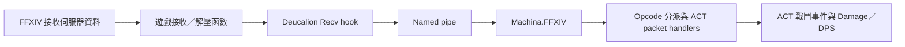

# FFXIV Global 7.57：Opcode 更新與 ACT 傷害解析修復技術報告

**日期：2026-10-13（Asia/Tokyo，UTC+09:00）**  
**工作目錄：`C:\Users\kyost\Desktop\git\ff14net`**  
**結果：已恢復封包接收；木人測試產生傷害事件，使用者確認 ACT 顯示 Damage／DPS。**

> **歷史紀錄。** 本報告對應遊戲 build `2026.10.06` 與 ACT 3.0.3.1。
> 現行流程見 [2026-10-20_deucalion-recv-repair.md](2026-10-20_deucalion-recv-repair.md)。
> 文中的 `tools/repair_deucalion_757.ps1` 已移除（見 git 歷史 `c7adcc4`），
> `tools/deucalion_probe.py` 已移到 `scripts/deucalion_probe.py`。

## 1. 問題與結論

本次先把使用者提供的 26 項 Global 7.57 opcode 寫入本地資料表及 ACT DLL。
重新讀取 DLL 的內嵌資源後，全部數值均吻合，但 ACT 的傷害／DPS 仍是 0。

後續診斷找到另一個獨立故障：**Deucalion 1.5.0 的預設接收 signature 在本地
7.57 遊戲程式中沒有匹配，導致接收 hook 未啟用。** 因此 ACT 雖然載入正確的
opcode 表，仍然收不到供傷害解析使用的伺服器封包。

修復包含兩部分：更新 Deucalion 的接收 signature，以及更新 ACT 內嵌 Machina
所預期的 native DLL checksum。安裝配對檔案、重新啟動 ACT 後，pipe 回報
`RECV ON`，實際收到 Zone 封包；木人測試產生 ACT type `21` 技能效果事件，
使用者確認畫面已有傷害／DPS 數字。

這是針對以下特定 executable 與 DLL 組合的修復。26 項 opcode 的**數值一致性**
全部已檢查；各種封包的**遊戲內解析行為**並未逐一測試。

## 2. 環境與檔案身分

| 項目 | 本次使用版本／位置 |
| --- | --- |
| 遊戲區域 | Global |
| 遊戲 patch | 7.57（使用者提供的版本標籤） |
| 遊戲 build | `2026.10.06.0000.0000`，來自 `ffxivgame.ver` |
| 遊戲程式 | `D:\Steam\steamapps\common\FINAL FANTASY XIV Online\game\ffxiv_dx11.exe` |
| ACT | `3.8.5.288` |
| FFXIV ACT Plugin | `3.0.3.1` |
| 內嵌 Machina.FFXIV | `2.4.7.9`，由 managed assembly metadata 確認 |
| Deucalion | `1.5.0` |
| 對照的 Deucalion source commit | `5cc714ad4cc66aced1519042660026edff68e850` |
| ACT 實際設定的 plugin 路徑 | `C:\Users\kyost\Desktop\FFXIV_ACT_Plugin.dll` |
| ACT 網絡日誌 | `D:\FFXIVLogs\Network_30301_20261013.log` |
| 本次遊戲 PID | `14016`；只適用於本次執行，不是固定值 |

下表 SHA256 是本次實際檔案的 hash；顯示版本相同並不足以證明檔案內容相同。

| 檔案 | 大小（bytes） | SHA256 |
| --- | ---: | --- |
| `ffxiv_dx11.exe` | 51,890,944 | `b38840761e2677128b6bec1ceaee3f2870cd84e1d38ab7958216373058383780` |
| 原始 Deucalion 1.5.0 | 2,975,744 | `326be4db261064ebb51b8c46d2940f55701d79887e2c65070aff00de4c8c65ef` |
| 修補後 Deucalion 1.5.0 | 2,975,744 | `fe84ded2594103a3319365306fa316bbaa9f80f7fc869803455cf9082529baeb` |
| 已更新 opcode、尚未修復 checksum 的 ACT DLL | 3,148,800 | `475ffe0274609a258435508e34aea1aa09d7ba3690fa4452120ea4cb4ce24749` |
| 最終修補 ACT DLL | 3,148,800 | `60a3247071bad7c616fabd2fc8ae17f59483d54bc2b96c47c727def8a7299fad` |

最終 ACT DLL 的 hash 指本次產出的 artifact；重新序列化 assembly 後應重新
計算 hash，並另外檢查 opcode、checksum 與安裝檔的一致性。

## 3. 資料流與故障位置



Opcode 決定收到封包後選用哪個 handler。Signature 則用於尋找遊戲內要掛接的
函數。兩者是不同層次：opcode 表正確，不能補救接收 hook 沒有啟用的情況。

本次已有 named pipe，`SEND`、`SEND_LOBBY`、`CREATE_TARGET` 亦已初始化。
直接 probe 可以收到 HELLO、debug 回覆及 ping，證明 pipe 通訊正常；但沒有
收到 `Recv`／Zone payload。故障位置在接收 hook，早於 opcode 分派。

Python 的 `analyze_deucalion.py` 主要標示封包名稱及部分 cast 資料，並不是本次
Damage／DPS 的解析器。使用者報告的症狀發生於 ACT。

## 4. 7.57 Opcode 表與來源

以下 **26 項數值全部來自使用者提供的 `Name|hex` 表**。本次沒有把它們描述為
重新從遊戲 executable 抽取的結果，也沒有以其他區域的數值替代。

ACT 表保留 ACT 命名；Python JSON 使用原有 upstream 命名對應。

| ACT 名稱 | Hex opcode | Python `ServerZoneIpcType` 名稱 |
| --- | --- | --- |
| StatusEffectList | `0x02CE` | StatusEffectList |
| StatusEffectList2 | `0x021B` | StatusEffectListBozja |
| StatusEffectList3 | `0x0097` | StatusEffectListPlayer |
| BossStatusEffectList | `0x039B` | StatusEffectListDouble |
| StatusEffectListForay3 | `0x022B` | StatusEffectListOccult |
| Ability1 | `0x00BD` | Effect |
| Ability8 | `0x013F` | AoeEffect8 |
| Ability16 | `0x0390` | AoeEffect16 |
| Ability24 | `0x009E` | AoeEffect24 |
| Ability32 | `0x0276` | AoeEffect32 |
| ActorCast | `0x0301` | ActorCast |
| EffectResult | `0x00F2` | EffectResult |
| EffectResultBasic | `0x0225` | EffectResultBasic |
| ActorControl | `0x0198` | ActorControl |
| ActorControlSelf | `0x01E6` | ActorControlSelf |
| ActorControlTarget | `0x00C8` | ActorControlTarget |
| UpdateHpMpTp | `0x03B7` | UpdateHpMpTp |
| PlayerSpawn | `0x0265` | PlayerSpawn |
| NpcSpawn | `0x0114` | NpcSpawn |
| NpcSpawn2 | `0x02F2` | NpcSpawn2 |
| ActorMove | `0x0217` | ActorMove |
| ActorSetPos | `0x03E0` | ActorSetPos |
| ActorGauge | `0x02EC` | ActorGauge |
| PresetWaymark | `0x01F8` | PlaceFieldMarkerPreset |
| Waymark | `0x0281` | PlaceFieldMarker |
| SystemLogMessage | `0x00EB` | SystemLogMessage |

實際更新的資料：

- `data/act_global_opcodes.txt`：26 項 ACT `Name|hex`，大小寫不影響數值。
- `data/opcodes.json`：Global 版本設為 `7.57`，只保留上述 26 項 Server Zone
  mapping。其他 Global list 清空，避免沿用未確認的舊版本數值；CN／KR／TW
  records 與修改前的工作檔內容相同。
- `data/xivalex_global_opcodes.json`：更新八項既有 S2C mapping；刪除未提供的
  `C2S_ActionRequest` 與 `C2S_ActionRequestGroundTargeted`。它仍是**不完整設定**。

此「未提供則 unknown」策略是 Python Global table 的處理方式。ACT patcher
只替換 26 個指定名稱，並沒有清空 ACT DLL 內其餘未指定的 opcode entries。
因此也不能把整份 ACT 內嵌表宣稱為完整驗證的 7.57 表。

## 5. 接收故障的可重現證據

### 5.1 ACT 載入位置正確

ACT 設定與啟動日誌均指向桌面 `FFXIV_ACT_Plugin.dll`。其 hash 與當時已更新
opcode 的 repository output 吻合，因此排除了「只產生新 DLL，但 ACT 仍載入
另一份舊 DLL」這個原因。

### 5.2 ACT 連線錯誤

本次 ACT 日誌在 `2026-10-13T20:15:41` 記錄：

```text
FFXIV_ACT_Plugin Game Connection
Failure:No data received from Deucalion.
```

此錯誤描述的是資料接收失敗，尚未進入傷害 payload 的解析階段。

### 5.3 Pipe probe

修復前直接連線 `\\.\pipe\deucalion-14016`，收到：

```text
SERVER HELLO. VERSION: 1.5.0. HOOK STATUS: RECV OFF. SEND ON. SEND_LOBBY ON. CREATE_TARGET ON.
```

八秒觀察期間有 debug 與 ping，`Recv`／Zone payload 數是 **0**。這份首次 probe
的輸出保留在本次 chat 的執行紀錄；當時並沒有另存完整 capture 檔。
後來的 `deucalion_health_before.json` 嘗試因 ACT 已關閉、pipe 消失而失敗，
不能把那次嘗試當作修復前成功保存的 capture。

### 5.4 Deucalion 自身錯誤

`%APPDATA%\deucalion\session-1791890081.log` 有以下關鍵內容：

```text
Scanning for RecvPacket sig: `E8 $ { ' } 4C 8B 4F 10 8B 47 1C 45`
Could not auto-initialize the Recv hook: Could not find a signature match for RecvPacket: E8 $ { ' } 4C 8B 4F 10 8B 47 1C 45
```

日誌亦有 `Processing deobfuscated packet ... but no packet was expected`。
這與 create-target hook 運作、但接收 hook 沒有建立預期 packet queue 的狀態一致；
它是輔助證據，主因由 signature 匹配失敗及 `RECV OFF` 直接支持。

## 6. Signature 分析與位址計算

### 6.1 原 pattern 與新 pattern

原始 Deucalion 1.5.0 source 的 `RECV_SIG`：

```text
E8 $ { ' } 4C 8B 4F 10 8B 47 1C 45
```

修正後：

```text
E8 $ { ' } 4C 8B 47 10 44 8B 4F 1C
```

原 pattern 在本地 executable 的匹配數是 **0**；新 pattern 對應的 byte sequence
匹配數是 **3**。差別可由 x86-64 編碼看出：

| 原 pattern 片段 | 原片段表示的指令 | 7.57 片段 | 7.57 片段表示的指令 |
| --- | --- | --- | --- |
| `4C 8B 4F 10` | `mov r9, [rdi+0x10]` | `4C 8B 47 10` | `mov r8, [rdi+0x10]` |
| `8B 47 1C` | `mov eax, [rdi+0x1c]` | `44 8B 4F 1C` | `mov r9d, [rdi+0x1c]` |

這是 pattern 字節所表示的寄存器改變；本次沒有成功完成完整函數反編譯，
不能把這張表解讀為已取得原始遊戲 source 或已比較兩個 build 的完整函數。

`E8` 是近距離相對 call。Pelite pattern 中 `$ { ' }` 跟隨 call 的相對目標，
保存目標位置。Deucalion 的 `find_pattern_matches(..., true)` 使用最深層保存的
RVA，因此掛接的是 call target，而不是 call instruction 本身。

### 6.2 三個匹配位置

本次 PE preferred image base 是 `0x140000000`。

| Source 順序所指定的 channel | Call file offset | Call RVA | Call preferred VA | Target RVA | Target preferred VA |
| --- | --- | --- | --- | --- | --- |
| Chat | `0x1D1D0AB` | `0x1D1DCAB` | `0x141D1DCAB` | `0x1D21C60` | `0x141D21C60` |
| Lobby | `0x1D27664` | `0x1D28264` | `0x141D28264` | `0x1D29A10` | `0x141D29A10` |
| Zone | `0x1D686D4` | `0x1D692D4` | `0x141D692D4` | `0x1D6AD10` | `0x141D6AD10` |

計算方法：

```text
target_RVA = call_RVA + 5 + signed_int32(call_bytes[1:5])
preferred_VA = preferred_image_base + RVA
```

Zone 的相對位移為 `0x1A37`：

```text
0x1D692D4 + 5 + 0x1A37 = 0x1D6AD10
0x140000000 + 0x1D6AD10 = 0x141D6AD10
```

File offset 透過 PE section mapping 轉成 RVA，兩者不可互換。執行時若有 ASLR，
實際 VA 應使用該次載入的 module base 加 RVA。

Deucalion `hook/recv.rs` 的 `setup()` 要求恰好三個結果，依序配置 Chat、Lobby、
Zone。表中 channel 名稱來自這個 source 的排序規則；本次實測觀察到 Zone
及 Chat payload，沒有單獨進行 Lobby 或重登入測試。

## 7. 修補實作

### 7.1 Native DLL：等長替換

原、新 pattern 的 ASCII 字串長度均為 **34 bytes**。原始 native DLL 中有三處
完整的原 pattern，檔案 offsets 為：

```text
0x148FC0
0x26DBCD
0x28B7C7
```

這三個 **DLL 字串 offsets** 與上一節的 **遊戲 call-site offsets** 是不同檔案的
座標。修補器替換完整 34-byte 字串，實際改變的 byte 總數是 **27**；檔案總大小
仍為 2,975,744 bytes。比對確認，輸出等於輸入做這三次字串替換的結果。

本次沒有修改遊戲 executable，也沒有重編 Deucalion 的接收邏輯。
修補版是原始 DLL 的字串修改產物。

### 7.2 ACT：更新配對 checksum

ACT 外層 DLL 內含 `costura.machina.ffxiv.dll.compressed`。`ActPluginPatch` 用
Mono.Cecil 讀取外層 assembly，解開 Deflate payload，找到：

```text
Machina.FFXIV.Deucalion.DeucalionInjector::get__checksum
```

原 checksum 是原始 Deucalion 的 SHA256，表示成以 `-` 分隔的 hex bytes。
修補器只替換這個 getter 的一個 `ldstr` 常數為修補後 native DLL 的實際 SHA256，
再重新序列化 Machina、壓縮並寫回 ACT resource。

`ValidateLibraryChecksum()` 仍會計算實際 DLL 的 SHA256 並比較預期值。
**Checksum 驗證沒有被停用。** 因此 ACT DLL 與 Deucalion DLL 必須成對安裝。

### 7.3 輸入防護與範圍

`repair_deucalion_757.ps1` 先核對遊戲 executable SHA256，再執行兩個步驟：
opcode patch，以及 native signature／embedded checksum patch。

底層 `patch-deucalion-757` 模式會檢查：

1. 輸入／輸出不是相同路徑，避免覆寫輸入。
2. 原始 native DLL hash 是本報告列出的 Deucalion 1.5.0 hash。
3. 新、舊字串等長，原字串恰好出現三次。
4. 內嵌 Machina 的原 checksum 與原始 native DLL 相符。

兩項負向測試均確認拒絕，且沒有寫出候選輸出：

- 已修改／不符合預期 hash 的 native DLL。
- Native input 正確，但 ACT 內嵌 checksum 已不符合預期的組合。

**遊戲 hash 防護在 PowerShell wrapper，並非底層 C# 模式。** 一般使用應從
wrapper 產生配對 bundle，避免直接執行底層模式而跳過遊戲 build 檢查。

## 8. 安裝與回復

Repository output 位於：

```text
C:\Users\kyost\Desktop\git\ff14net\tools\third_party\patch\
  FFXIV_ACT_Plugin.dll
  deucalion-1.5.0.dll
  deucalion-1.5.0.distrib.dll
```

本次在確認 ACT 已關閉後，備份桌面原檔，再將三個檔案安裝到 ACT 已設定的
桌面 plugin 目錄。ACT 重開後，實際桌面 ACT DLL 與 native DLL 的 bytes／hash
均與配對 bundle 相同。

`.distrib.dll` 在重開後已不再出現在桌面；本次沒有單獨追蹤其移動／移除的程式
路徑。不要將它是否仍存在作為成功訊號；應檢查實際 native DLL、pipe payload
及 ACT 傷害結果。

### 8.1 重新產生

```powershell
Set-Location 'C:\Users\kyost\Desktop\git\ff14net'
.\tools\repair_deucalion_757.ps1
```

此命令需要本地 ACT 3.0.3.1 原始檔案、.NET 10 SDK，以及本報告對應的遊戲 build。
Wrapper 要求原始輸入放在下列固定位置：

```text
tools/third_party/FFXIV_ACT_Plugin_3.0.3.1/
  FFXIV_ACT_Plugin.dll
  deucalion-1.5.0.distrib.dll
```

本機有 `tools/third_party/FFXIV_ACT_Plugin_3.0.3.1.zip`，但它在本次工作樹屬於
untracked 檔案。新 clone 若缺少原檔，可從
[官方 ACT 3.0.3.1 release](https://github.com/ravahn/FFXIV_ACT_Plugin/releases/tag/3.0.3.1)
取得該版本的 plugin archive，解壓到上述目錄；不要用已修補的桌面 DLL 代替
原始輸入。Native 原檔的 hash 必須符合第 2 節。

本次 helper target framework 為 `net10.0`，依賴 `Mono.Cecil 0.11.6`。
它只在 repository 產生 bundle，不會自行安裝到桌面或重啟 ACT。

### 8.2 安裝檔案

先關閉 ACT，並關閉其他 Deucalion subscribers，讓目前注入的 DLL 卸載；若
pipe 持續存在，應先找出剩餘 subscriber，或重新啟動遊戲後才驗證新 DLL。
確認設定仍載入桌面的 plugin，**為這次安裝建立新的備份**，再複製 output：

```powershell
Set-Location 'C:\Users\kyost\Desktop\git\ff14net'
$ErrorActionPreference = 'Stop'
if (Get-Process -Name 'Advanced Combat Tracker' -ErrorAction SilentlyContinue) {
    throw '先關閉 ACT。'
}
$taskDesktop = 'C:\Users\kyost\Desktop'
$taskNames = @('FFXIV_ACT_Plugin.dll', 'deucalion-1.5.0.dll', 'deucalion-1.5.0.distrib.dll')
foreach ($taskName in $taskNames) {
    if (-not (Test-Path -LiteralPath (Join-Path 'tools\third_party\patch' $taskName) -PathType Leaf)) {
        throw "Bundle 缺檔：$taskName"
    }
}
$taskBackup = Join-Path (Get-Location) ('build\act-backup-' + (Get-Date -Format 'yyyyMMdd-HHmmss'))
New-Item -ItemType Directory -Path $taskBackup -ErrorAction Stop | Out-Null
foreach ($taskName in $taskNames) {
    $taskDestination = Join-Path $taskDesktop $taskName
    if (Test-Path -LiteralPath $taskDestination) {
        Copy-Item -LiteralPath $taskDestination -Destination (Join-Path $taskBackup $taskName) -ErrorAction Stop
    }
}
# 全部 bundle inputs 存在、全部備份成功後，才開始覆寫安裝檔。
foreach ($taskName in $taskNames) {
    $taskDestination = Join-Path $taskDesktop $taskName
    Copy-Item -LiteralPath (Join-Path 'tools\third_party\patch' $taskName) `
      -Destination $taskDestination -Force -ErrorAction Stop
}
Write-Host "這次的備份：$taskBackup"
```

再以管理員身分啟動 ACT。若 plugin 設定已改到其他資料夾，安裝目的地亦必須
跟著改，不能只按本報告的舊路徑複製。

先驗證已安裝檔案與本次 bundle 的 hash 相同：

```powershell
foreach ($taskName in @('FFXIV_ACT_Plugin.dll', 'deucalion-1.5.0.dll')) {
    $taskInstalledHash = (Get-FileHash -LiteralPath (Join-Path $taskDesktop $taskName)).Hash
    $taskBundleHash = (Get-FileHash -LiteralPath (Join-Path 'tools\third_party\patch' $taskName)).Hash
    if ($taskInstalledHash -ne $taskBundleHash) { throw "安裝檔與 bundle 不同：$taskName" }
    Write-Host "PASS: $taskName"
}
```

以下讀取已安裝 ACT 的內嵌 getter，獨立核對 native checksum。需先成功執行
wrapper，讓 helper 的 `Mono.Cecil.dll` 已存在；本次亦實際執行此檢查並通過：

```powershell
Add-Type -Path '.\tools\ActPluginPatch\bin\Debug\net10.0\Mono.Cecil.dll'
$taskOuter = [Mono.Cecil.ModuleDefinition]::ReadModule((Join-Path $taskDesktop 'FFXIV_ACT_Plugin.dll'))
$taskResource = $taskOuter.Resources | Where-Object Name -eq 'costura.machina.ffxiv.dll.compressed'
$taskSourceStream = $taskResource.GetResourceStream()
$taskInflater = [IO.Compression.DeflateStream]::new($taskSourceStream, [IO.Compression.CompressionMode]::Decompress)
$taskBuffer = [IO.MemoryStream]::new()
$taskInflater.CopyTo($taskBuffer)
$taskBuffer.Position = 0
$taskInner = [Mono.Cecil.ModuleDefinition]::ReadModule($taskBuffer)
$taskType = $taskInner.Types | Where-Object FullName -eq 'Machina.FFXIV.Deucalion.DeucalionInjector'
$taskGetter = $taskType.Methods | Where-Object Name -eq 'get__checksum'
$taskExpected = ($taskGetter.Body.Instructions | Where-Object { $_.OpCode.Code.ToString() -eq 'Ldstr' }).Operand
$taskNativeHash = (Get-FileHash -LiteralPath (Join-Path $taskDesktop 'deucalion-1.5.0.dll')).Hash
$taskActual = ([regex]::Matches($taskNativeHash, '..').Value -join '-')
$taskMatches = $taskExpected -ieq $taskActual
$taskInner.Dispose()
$taskOuter.Dispose()
$taskInflater.Dispose()
$taskSourceStream.Dispose()
$taskBuffer.Dispose()
if (-not $taskMatches) { throw 'Embedded checksum 與 native DLL 不相符。' }
Write-Host 'PASS: embedded checksum 與 native DLL 相符。'
```

### 8.3 備份與 rollback

本次桌面檔案備份：

```text
C:\Users\kyost\Desktop\git\ff14net\build\desktop-act-before-recv-fix\
```

較早的 JSON table 及 repository patched ACT DLL 備份：

```text
C:\Users\kyost\Desktop\git\ff14net\build\opcode-backups\before-7.57\
```

兩個備份資料夾用途不同；後者沒有另存修改前的 ACT opcode text。
`build/` 與 `captures/` 被 Git 忽略，因此它們是本機證據／備份，不能假設
其他 clone 亦擁有這些檔案。

本次 `desktop-act-before-recv-fix` 備份確實有以下兩個檔案：

| 備份檔名 | 還原目的地 |
| --- | --- |
| `FFXIV_ACT_Plugin.dll` | `C:\Users\kyost\Desktop\FFXIV_ACT_Plugin.dll` |
| `deucalion-1.5.0.dll` | `C:\Users\kyost\Desktop\deucalion-1.5.0.dll` |

Rollback 時先關閉 ACT 及其他 Deucalion subscribers，確保目前注入的 DLL 已
卸載；必要時重新啟動遊戲。從上述本次備份複製兩個檔案回目的地。
若桌面仍有本次新增的 `deucalion-1.5.0.distrib.dll`，先確認它的 hash 是修補版
`fe84ded2...`，再移走該檔，避免重新啟動時混用不同配對；若其內容不同，應先
查清來源，不能直接刪除。原桌面沒有 `.distrib.dll`，因此這個 historical
rollback 不需要另補 distribution 檔。

若改為重新建立原始 native 配對，才需要從原始
`tools/third_party/FFXIV_ACT_Plugin_3.0.3.1/` 取得 distribution DLL。
本次 historical 備份的 ACT DLL 已包含 26 項 7.57 opcode，但 checksum 尚未
修復；還原會回到本次已知的 `RECV OFF` 故障狀態，並非另一個可用修正。
新安裝者應使用自己第 8.2 節產生的備份，而不是假設存在本次 historical 備份。
對三個檔名逐一處理：自己備份內存在的檔案，還原到原安裝目的地；自己備份內
不存在、但這次新安裝的檔案，應移走，使安裝目錄回復原來的檔案集合。
此規則包括 `.distrib.dll`，也包括原先沒有的 ACT 或 native DLL。移走前應核對
它仍是這次安裝的 bundle 內容；若其後已被別的版本替換，先查清狀態再操作。

## 9. 驗證結果與界限

| 驗證項目 | 證據 | 結果與界限 |
| --- | --- | --- |
| 26 項 opcode 數值 | ACT text、Python map、DLL resource dump | 全部一致；不是逐一 live packet 測試 |
| 其他區域資料 | 修改前後 JSON records 比較 | CN／KR／TW 工作檔內容相同 |
| Native 修改範圍 | 逐 byte 比較 | 只有三處等長 signature 替換，27 bytes 不同 |
| Checksum 配對 | 讀取內嵌 getter、計算 native SHA256 | 相符；驗證方法仍保留 |
| 安裝位置 | ACT config／啟動日誌、桌面檔案比對 | 載入本次修補版 |
| 接收 hook | 修復後 HELLO | `RECV ON` |
| 實際接收 | 八秒 probe | 4 個 Zone、1 個 Chat payload |
| ACT 技能效果 | 木人測試日誌 | 5 筆 type `21`，其中 4 筆為非零 damage effect |
| 最終顯示 | 使用者測試回覆 | ACT Damage／DPS 已顯示數字 |

### 9.1 修復後 probe

```powershell
Set-Location 'C:\Users\kyost\Desktop\git\ff14net'
python .\scripts\deucalion_probe.py --seconds 8 `
  --output .\captures\deucalion_health_after.json
```

本次保存的結果節錄如下。數量屬於這個八秒視窗，並不是吞吐量 benchmark：

```json
{
  "pid": 14016,
  "seconds": 8.0,
  "recv_initialization_requested": false,
  "frame_counts": {
    "0:9000": 2,
    "0:0": 1,
    "1:0": 8,
    "3:1": 4,
    "3:2": 1
  },
  "zone_opcodes": {
    "0x01e5": 1,
    "0x0245": 1,
    "0x03e7": 1,
    "0x01e6": 1
  },
  "recv_zone_packets": 4
}
```

這裏 opcode `0x01E6` 是 ActorControlSelf；其餘三個不在已提供的 26 項表中。
Unknown opcode 仍可作為「實際收到 Zone payload」的證據，但不能推斷其名稱。
這個 probe 視窗在木人攻擊之後，沒有擷取 Ability1 packet；傷害證據來自 ACT
稍早的戰鬥日誌，兩組觀察不可混為同一個 capture。

Probe 的退出碼：`0` 表示觀察到接收 Zone payload；`2` 表示視窗內沒有；
連線／檔案等例外會非零退出，並可能沒有產生 JSON。命令自動選擇唯一的
Deucalion pipe；有多個 pipe 時必須指定 `--pid`。

`--initialize-recv-757` 會在核對遊戲 hash 後，透過現有 Deucalion protocol
提交新 signature。本次最終驗證沒有使用這個模式；使用的是重新啟動後的
native DLL 自動初始化。HELLO hook flags 在 server 啟動時設定，手動初始化後
可能仍顯示舊值；此時應以實際 payload 為驗證訊號。

### 9.2 木人傷害證據

以下節錄保留時間、action ID 與原始 effect 欄位，省略角色名稱及 actor IDs。
`21` 是 ACT log event type，並非 network opcode `0x21`。

| 時間（2026-10-13，JST） | ACT type | Action ID（hex） | Effect flags（hex） | Effect value（hex） |
| --- | --- | --- | --- | --- |
| 20:29:05.312 | 21 | `409C` | `FD50E` | `07670000` |
| 20:29:10.286 | 21 | `6509` | `754003` | `A0B40000` |
| 20:29:12.769 | 21 | `6509` | `752003` | `D0120000` |
| 20:29:19.116 | 21 | `6509` | `752003` | `CC570000` |
| 20:29:21.734 | 21 | `6509` | `750003` | `82BB0000` |

後四筆 effect type 的低 byte 是 `03`，具有非零傷害資料。表中 value 保留原始
hex 編碼，沒有將整個 32-bit 欄位當作十進位傷害數字。第一筆低 byte 為 `0E`，
不能只因為是 type `21` 就把它也算成 damage effect。

最後使用者確認「已有傷害／DPS 數字」，完成本次回報症狀的端到端驗證。
本次沒有記錄精確 DPS 數值，也沒有與遊戲顯示的傷害逐項對帳。

## 10. 保留限制與後續更新注意事項

1. 修補只對本報告的 Global 7.57 executable hash 有證據。下一次 hotfix 即使
   patch 名稱相同，也應重新核對 build、hash、匹配數及 live reception。
2. 未逐一測試 Ability8／16／24／32、status lists、spawn、waymarks、Lobby
   接收、長時間穩定性或所有職業；不能據此宣稱完整相容。
3. XIVAlexander 缺兩項 C2S opcode，仍不能作為完整設定交付。
4. `tools/patch_act_plugin.cmd` 只更新 opcode，重新執行會產生預期原始 native
   checksum 的 ACT DLL。使用修補版 native 時，要再執行
   `tools/repair_deucalion_757.ps1` 產生配對 bundle。
5. `tools/update_opcode_data.bat` 會以 upstream 資料覆寫本地表；它不是本次
   手動 7.57 表及 hook 修復的重現方法。
6. 此作法修改 built artifacts，並非 ACT source rebuild；原 assembly 身分資訊
   不能視為修改後內容仍有原發行者的簽章驗證。
7. REA／Ghidra 的 Zone 函數反編譯請求在 300 秒後 timeout，沒有可引用的成功
   pseudocode。成功結論來自字節匹配、Deucalion source、assembly metadata／CIL
   檢查及實際 ACT 測試，而非完整反編譯結果。

## 11. 重現入口與證據索引

| 檔案／資料 | 用途 |
| --- | --- |
| `tools/repair_deucalion_757.ps1`（已移除，見 git 歷史 `c7adcc4`） | 核對遊戲 build，產生配對 DLL |
| [scripts/deucalion_probe.py](../scripts/deucalion_probe.py) | 有時間上限的 pipe health probe |
| [tools/ActPluginPatch/Program.cs](../tools/ActPluginPatch/Program.cs) | Opcode patch 與 `patch-deucalion-757` 實作 |
| [2026-10-13_deucalion-recv-repair.md](2026-10-13_deucalion-recv-repair.md) | 簡短修復／操作說明 |
| [../data/act_global_opcodes.txt](../data/act_global_opcodes.txt) | 使用者提供的 26 項 opcode |
| `captures/deucalion_health_after.json` | 本機保存的修復後 probe；Git ignored |
| ACT／Deucalion session logs | 連線錯誤、初始化及戰鬥事件原始證據 |

直接讀取最終 ACT 內嵌 opcode 的命令：

```powershell
Set-Location 'C:\Users\kyost\Desktop\git\ff14net'
dotnet run --project .\tools\ActPluginPatch -- dump `
  .\tools\third_party\patch\FFXIV_ACT_Plugin.dll Global
```

對照的第一手 source：

- [Deucalion 1.5.0 固定 commit](https://github.com/ff14wed/deucalion/tree/5cc714ad4cc66aced1519042660026edff68e850)。
- [預設 signature 與自動初始化](https://github.com/ff14wed/deucalion/blob/5cc714ad4cc66aced1519042660026edff68e850/deucalion/src/lib.rs)。
- [接收 hook 的三個 channel 配置](https://github.com/ff14wed/deucalion/blob/5cc714ad4cc66aced1519042660026edff68e850/deucalion/src/hook/recv.rs)。
- [Pattern scanner 與 deepest match](https://github.com/ff14wed/deucalion/blob/5cc714ad4cc66aced1519042660026edff68e850/deucalion/src/procloader.rs)。
- [Pipe protocol 與手動 Recv signature](https://github.com/ff14wed/deucalion/blob/5cc714ad4cc66aced1519042660026edff68e850/README.md)。

Managed artifact 檢查的 REA Evidence IDs：

```text
ACT outer metadata:
ev_d5ff10e467075179c4b67fb64218eb0e146c16f2a688881327ef94b3c4647551

Extracted Machina.FFXIV members:
ev_7316743522a1244ddb0b5b0997b4aa3e4a51cd6595d45baa248ad8a3d98d4ea6

Extracted ACT Network members:
ev_56fbcd6164472bcb084201961ea5163fb09159425da5408c95ba8140b5499be4
```

Evidence IDs 是本次分析 session 的索引，不能假設另一個 session 可直接讀取。
本報告已內嵌主要 hash、位址、probe 統計及戰鬥欄位，避免依賴 session index
或本機 ignored 檔案才能理解修復原因與結果。
